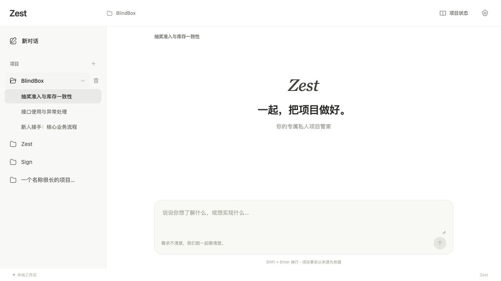
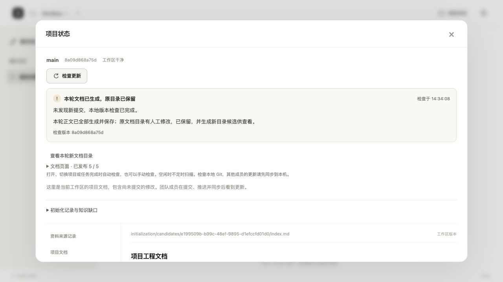

# Zest

**Your personal project steward.**

A local project assistant that learns a Git repository, answers questions with sources, and maintains readable engineering documentation as the code changes.

[English](README.md) · [简体中文](README.zh-CN.md) · [Releases](https://github.com/ZengYYoung/Zest/releases) · [Report an issue](https://github.com/ZengYYoung/Zest/issues)

**First release: `v0.1.0-alpha.1` — local, single-user Alpha.** DeepSeek is the only supported model provider. This is a source release; desktop installers, a hosted service, and production multi-user support are not included.

## Why Zest?

Understanding a project should not start from scratch every time you open a chat. Zest keeps project documents, reviewed findings, source references, and conversation history together, so you can return to questions such as:

- Where does this request go, and which modules work together?
- How is this interface used, and what constraints does it have?
- What changed since the last investigation, and which documents need attention?

The Web workspace is the primary interface. Conversations stay central; settings, documents, and maintenance details open when needed.

## Features

| Capability | Included in this Alpha |
| --- | --- |
| Project workspace | Add local Git projects, browse conversations by project, and remove a project from the list without deleting its files. |
| Automatic initialization | Create `.zest/`, organize existing documentation, index committed source, investigate the project, and generate topic-based engineering pages. |
| Project Q&A | Ask in natural language using project knowledge, source excerpts, and previous turns; inspect the answer's sources. |
| Engineering documentation | Plan, write, review, and save individual pages; preserve human edits and offer generated candidates when they conflict. |
| Incremental maintenance | Check local Git on project open/switch, task completion, or manual request; investigate changes and update affected knowledge and pages. |
| Visible execution | Show activity, stages, elapsed time, page counts, and explicit completion or failure; retain receipts for recovery. |
| Shared knowledge, private state | Share selected `.zest/docs/` files through Git while keeping conversations, databases, credentials, and execution state local. |

CLI workflows also provide investigation, repair proposals, candidate changes, Docker-based verification, and version operations. The complete “clarify a request → develop → test → deliver” workflow is **not yet connected end to end in the main chat**.

## Screenshots

The workspace screenshot uses sample conversation data. The document-status screenshot comes from a real local BlindBox trial; it demonstrates one completed document round, not an overall accuracy benchmark.



<details>
<summary>Document generation and maintenance status</summary>



</details>

## Quickstart

### Prerequisites

- **Git** and a local repository with at least one commit for source investigation.
- **Python 3.11+** and [uv](https://docs.astral.sh/uv/getting-started/installation/).
- **Node.js 22.12+** and npm to build the Web frontend.
- A **DeepSeek API key** with access to the configured model. Model calls incur provider charges.

macOS is the primary trial platform. The native folder picker requires macOS; other Unix environments can enter a path manually, but have not received equivalent release validation. Native Windows support is not validated; parts of the backend use Unix file locks. Docker is optional for advanced verification workflows, not for ordinary project Q&A.

### 1. Get the release and install dependencies

```bash
git clone --branch v0.1.0-alpha.1 https://github.com/ZengYYoung/Zest.git
cd Zest

uv sync --locked --extra ai --extra web
npm --prefix frontend ci
npm --prefix frontend run build
```

### 2. Start the local workspace

Run from the Zest checkout and keep the terminal open:

```bash
uv run --locked --extra ai --extra web zest web serve --port 8000
```

Open **[http://127.0.0.1:8000](http://127.0.0.1:8000)**. No account, login, or Web token is required. Stop the service with `Ctrl+C`.

### 3. Connect your model and project

1. Open **Settings (设置)**, enter your DeepSeek API key, and save. Saving is local; the optional connection test makes one real model call.
2. Click **+** beside **Projects (项目)**. Choose a local Git repository or enter its absolute root path.
3. Click **Connect and initialize (接入并初始化)**. This enables automatic project understanding for that project: permitted committed source and documentation are sent to DeepSeek for investigation and document generation.
4. Follow the progress, then ask a question. Open **Project status (项目状态)** to read documents, check updates, or inspect unfinished work.

Research and explicitly started document rounds are bounded to **32 physical model calls and 30 minutes per round**. These limits are not a fixed-price guarantee. Some projects or pages may remain incomplete when evidence, time, or call capacity is insufficient. A new document round requires its explicit action and can incur further charges.

The interface currently uses Chinese labels; this release provides documentation in both English and Chinese.

## How `.zest/` works

Zest adds a resource directory to each connected project:

```text
your-project/
├── src/                         # Your existing code stays in place
└── .zest/
    ├── workspace.json           # Local project identity and storage routing
    ├── AGENTS.md                # Generated management/navigation guide
    ├── .gitignore               # Shared-document vs. local-state rules
    ├── docs/                    # Project documents eligible for Git sharing
    │   ├── index.md
    │   ├── imported/            # Imported documentation with source records
    │   ├── initialization/      # Generated topic pages and conflict candidates
    │   └── generated/           # Portable knowledge manifest
    └── state/                   # Private local state; created as needed
        ├── state.sqlite3
        ├── conversations.sqlite3
        ├── cognition.sqlite3
        ├── index.sqlite3
        └── …                    # Tasks, snapshots, checkpoints, locks, receipts
```

- **SQLite is file-based.** No separate database server is required. Application records are split across databases rather than stored in one universal file.
- **Documents and state have different lifecycles.** Zest maintains project documents under `.zest/docs/`; existing README/docs can be read and imported while their originals remain. Generated documents are not automatically committed or pushed.
- **Sharing is explicit.** Review and commit the intended documentation and ignore rules, then push and synchronize through Git. Teammates get committed documents, not your personal conversations or SQLite files. Existing custom ignore rules can still prevent documents from being tracked.
- **Not everything is project-local yet.** The service's project catalog, Web-operation receipts, and model settings live in its selected state directory—by default `<directory-you-start-Zest-in>/.zest/`. Historical records may remain in their original storage locations, referenced by `workspace.json`.
- **Human edits are preserved.** Conflicts produce candidates instead of silently replacing edited files. Completed pages can have a new candidate index while the original index remains unchanged.
- **Removing a project is recoverable.** The delete button hides its catalog entry; source, `.zest/`, and history remain. Reconnecting the same directory restores its identity. Already-started background work is not cancelled.

To choose a different service state directory, put the global option **before** the subcommand:

```bash
uv run --locked --extra ai --extra web zest --state-dir /absolute/path/to/zest-state web serve --port 8000
```

This changes the catalog/configuration location; it does not automatically migrate old databases. Existing projects can still reference earlier storage, so a complete backup may need both project resources and the original service state directory.

## Model support and data handling

| Setting | This release |
| --- | --- |
| Supported provider | DeepSeek only |
| Web model preset | `deepseek-flash` |
| Official base URL | `https://api.deepseek.com` |
| Structured-output endpoint | `https://api.deepseek.com/beta/chat/completions` |
| Recommended configuration | Enter the API key in Web settings |
| Optional CLI configuration | Environment variables shown in [`.env.example`](.env.example); saved Web settings take precedence |

Other providers, local models, and arbitrary OpenAI-compatible endpoints are **not supported by this release**. The preset is an application configuration, not a promise of account/model availability.

Project source excerpts, documentation, and relevant conversation context leave your machine when model operations execute. API keys stay on the service side; Web settings store the key **unencrypted** in `model-settings.json` in the service state directory, with owner-only file permissions. They are not returned to the browser or put into shared project documents. Local operation and investigation records can contain project excerpts; treat those private state directories accordingly.

The server binds to `127.0.0.1` and checks local Host/Origin. It is intended for one local user, with no production authentication or remote collaboration layer. See [model configuration](.zest/docs/model-settings.md) for details.

## How maintenance works

```text
Committed Git version → source retrieval → investigation and review
                                              ↓
Project Q&A ← reviewed knowledge ← topic pages and source references
                                              ↑
                   Local Git changes → incremental maintenance
```

Investigations read a fixed Git commit. The document viewer can show current workspace files, including uncommitted document edits; those two views are intentionally distinguished. Zest does not pull remote changes or continuously scan while idle. Synchronize teammates' changes locally before checking.

Recovery reuses saved results and completed pages where possible. Requests with unknown execution results are not automatically replayed. Pages that lack evidence or fail review remain unfinished, and knowledge gaps are kept visible. “Published” or “reviewed” is workflow state, not proof that a model understands every part of a project.

## Current limits and roadmap

This Alpha is for local evaluation. One real BlindBox document round published **5/5 pages using 27 model calls** while preserving the original edited index. It validates that bounded workflow, not general documentation accuracy, large-repository reliability, or deployment behavior.

Next priorities are broader project-Q&A quality evaluation, more sustained incremental-maintenance trials, and a stable release baseline. Server deployment, PostgreSQL-backed multi-user collaboration, complete cross-branch/merge/deployment tracking, additional model providers, and end-to-end autonomous development remain future work.

## Development and contributing

```bash
# Install optional integrations used by the backend test suite.
uv sync --locked --extra ai --extra web --extra mcp --extra tui
uv run --locked --extra ai --extra web --extra mcp --extra tui python -m unittest discover -s tests -q

npm --prefix frontend test
npm --prefix frontend run build

# Optional frontend dev server; run the API on port 8000 in another terminal.
npm --prefix frontend run dev
```

The development frontend runs at `http://127.0.0.1:5173`. Tests use temporary repositories, offline models, and mocked transports; passing them does not establish real-model semantic accuracy.

Bug reports and focused pull requests are welcome. Include reproduction steps, platform/tool versions, and redacted logs; keep API keys, private source, local databases, and model request receipts out of issues and commits.

- [Release notes](.zest/docs/releases/v0.1.0-alpha.1.md)
- [Current engineering documentation](.zest/docs/index.md)
- [Project initialization](.zest/docs/initialization.md) · [Incremental maintenance](.zest/docs/maintenance.md)
- [Engineering page generation](.zest/docs/engineering-documents.md)
- [`docs/`](docs/): historical design and acceptance records; some describe superseded interfaces.

## License

A project license has not yet been selected. This release does not introduce a license grant.
