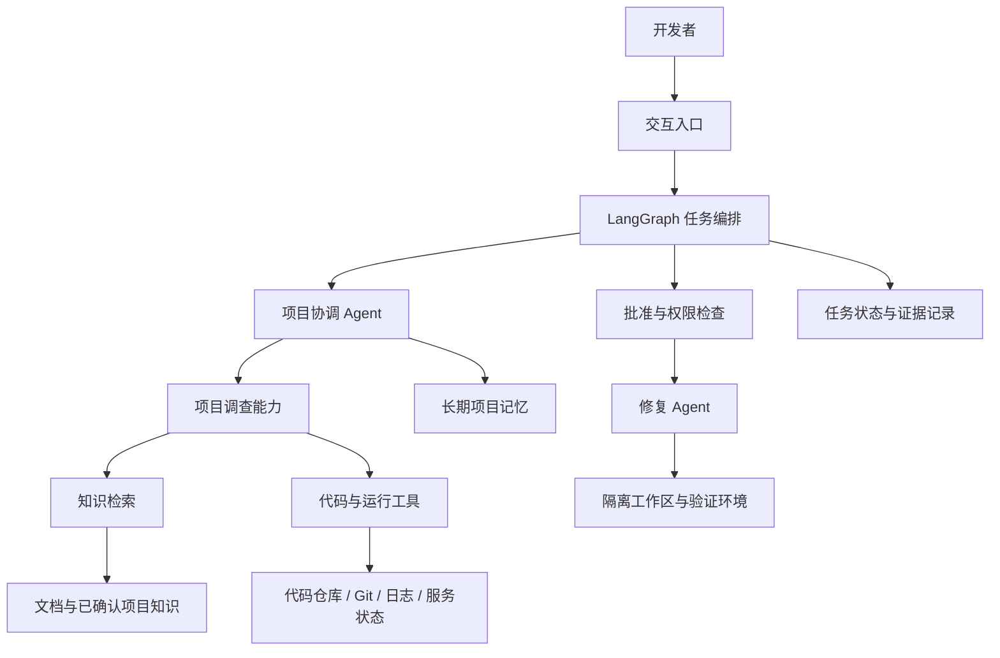

# Zest 开发设计文档

- 版本：0.1
- 日期：2026-10-13
- 状态：总体设计草案；M001—M011 已实现接入、证据问答、长期知识和有界 Agent 协作
- 仓库：[ZengYYoung/Zest](https://github.com/ZengYYoung/Zest)

## 1. 文档用途与决策规则

本文记录已经确认的产品方向，并提供后续逐项讨论的设计框架。它不是已经实现的功能清单，也不代表所有技术选型已经确定。

全文使用三种状态：

| 状态 | 含义 |
| --- | --- |
| 已确认 | 已在项目讨论中明确认可，开发应遵循 |
| 建议 | 本文提出的实现方案，进入开发前需要针对该设计点确认 |
| 待确认 | 尚未做出选择，不应据此编写不可逆的实现 |

推进方式：每次最多确认一个功能或设计点，明确输入、输出、权限和验收标准，再实现和验证。新需求和变更应更新本文或补充对应设计记录。

当前已实现本地项目创建/导入、版本证据、检索问答、批准任务、长期知识、词法 RAG 和只读 MCP 专业 Agent 协作。修复、验证和版本切换继续分模块实现。实现进度见第 17 节和 [开发日志](DEVLOG.md)。

## 2. 产品定位

**已确认：Zest 是面向单一项目、长期服务的项目维护 Agent。**

Zest 帮助开发者理解项目，结合代码、文档、历史记录和运行证据进行调查，提出开发或维护方案，并在获得批准后执行受控修改与验证。

它的长期价值在于持续积累项目上下文：不仅知道当前实现是什么，还能利用经过确认的需求、设计决策、维护结果解释为什么这样实现。

“理解整个项目”是持续建设的目标。系统必须区分已查证事实、推测和缺失信息，不能把一次扫描描述为完整理解。

### 2.1 两种模式

**已确认：支持开发模式和导入模式，共用长期维护能力。**

| 维度 | 开发模式 | 导入模式 |
| --- | --- | --- |
| 起点 | 从项目创建或早期开发开始参与 | 接手已有项目 |
| 初始知识 | 用户提供的目标、需求和约束 | 代码、文档、配置、Git 历史及用户补充 |
| 知识积累 | 跟随设计、开发、验证逐步形成 | 调查后建立初始理解，再通过维护任务完善 |
| 主要缺口 | 尚未做出的设计与尚未实现的功能 | 未记录的设计背景、过时文档和缺失记录 |
| 后续能力 | 理解、开发、诊断、维护、更新 | 同左 |

模式表示项目接入方式，不自动授予修改、执行或发布权限。一个导入的项目也可以继续由 Zest 开发，不需要更换另一套 Agent。

### 2.2 目标用户与典型问题

建议先面向项目开发者和接手项目的维护者，不在第一版引入复杂组织体系。

- 理解：“项目怎么启动？这个接口经过哪些模块？”
- 交接：“这个设计为什么采用异步处理？还有哪些未解决问题？”
- 诊断：“这个接口为什么超时？证据是什么？”
- 迭代：“增加取消订单功能，会影响什么？”
- 修复：“按照已批准的方案修复，并给出验证结果。”

这些场景是目标方向，不要求第一版同时完成。

## 3. 已确认事项与待定边界

### 3.1 已确认事项

| 编号 | 决策 |
| --- | --- |
| D-001 | 项目名称为 Zest，定位为单一项目的长期维护 Agent |
| D-002 | 支持开发模式和导入模式，两者共用维护能力 |
| D-003 | 采用知识检索、代码及运行工具、长期记忆相结合的总体架构 |
| D-004 | LangChain 组织模型、检索和工具能力，LangGraph 编排有状态的任务流程 |
| D-005 | 包含专业 Agent 分工与 MCP 工具接入；具体角色和工具范围待确认 |
| D-006 | 先诊断并提出建议，修复由专门 Agent 在用户批准后执行 |
| D-007 | 修改应隔离进行，验证通过后才允许切换版本，并保留回退能力 |
| D-008 | 使用 Git 进行版本控制，GitHub 托管与协作；逐项确认后开发 |

### 3.2 仍待确认

- 两种模式已有本地 CLI 接入；完整用户界面和远程 GitHub URL 接入仍待确认。
- 首批支持的语言、框架和项目规模。
- 基础模块已有 CLI 验证入口；完整产品是否采用 Web 等界面仍待确认。
- 首个模块已采用本地 Git 仓库根路径登记；GitHub URL 接入方式待确认。
- 当前使用 Python、SQLite、DeepSeek、LangChain/LangGraph 和 FastMCP；生产后端、数据库和语义 Embedding 方案仍待确认。
- 第一版自动修复的范围，以及是否接入实际部署环境。
- 协作记录先存储在本地，还是接入 GitHub Issues/PR。
- 测试、构建、发布的权限策略与具体执行环境。

此前讨论过的 Java、React、Redis、消息队列和订单实验系统均是候选方案，不是当前已确认的工程约束。

## 4. 总体架构

**已确认：Zest 不依赖单一的向量知识库，而是组合不同的信息获取方式。**



图中的能力边界是总体方向，不表示每个框都必须部署成独立服务。

### 4.1 各层职责

| 层次 | 职责 | 不负责的事项 |
| --- | --- | --- |
| 交互入口 | 提交问题、显示证据和进度、收集批准 | 决定工具权限 |
| 任务编排 | 管理任务状态、路由、暂停恢复和预算 | 独立判断所有业务问题 |
| Agent | 理解目标、形成假设、选择调查步骤、提出方案 | 绕过程序约束与审批 |
| 检索层 | 找到相关资料，返回来源与适用版本 | 保证文档永远正确 |
| 工具层 | 按契约读取代码、查询状态、执行允许操作 | 接受模型自行扩大权限 |
| 持久化层 | 保存状态、证据、决策、批准、验证和版本关系 | 把聊天内容自动视为可信知识 |

### 4.2 LangChain 与 LangGraph

LangChain 用于模型接入、检索组件、工具调用及专业 Agent 的执行循环。LangGraph 用于整个任务的状态和步骤控制，可以组合程序逻辑与模型判断。[官方总体说明](https://docs.langchain.com/oss/python/langgraph/overview)

建议在具体实现中划分：

- **模型判断**：问题理解、调查计划、原因假设、影响分析、修改方案。
- **程序规则**：身份与权限检查、预算、审批有效性、版本一致性、是否满足切换条件。

审批和验证门槛不能只通过 Prompt 约束。

## 5. 项目知识如何建立和更新

### 5.1 信息分类

| 信息 | 获取和保存方式建议 |
| --- | --- |
| 架构、需求、业务规则、维护手册 | 文档存储与 RAG 检索 |
| 当前代码、配置、测试、Git 差异 | 搜索定位并读取对应快照的原文 |
| 日志、指标、部署状态 | 实时工具查询，结果形成带时间的证据 |
| 设计决策、项目约束、已确认维护结果 | 长期结构化记录，可建立检索索引 |
| 本次调查计划、假设、批准与进度 | 任务状态和执行记录 |

RAG 指检索相关外部资料后用于生成回答的流程，并不是一种包办所有数据的数据库。已有数据源也可以直接通过工具查询。[官方检索说明](https://docs.langchain.com/oss/python/deepagents/retrieval)

### 5.2 导入模式的候选流程

1. 用户指定项目及允许访问的范围。
2. 记录仓库、分支、commit，以及工作区是否包含未提交修改。
3. 只读扫描目录、依赖声明、入口、文档、配置模板和测试。
4. 建立项目概览与文档索引，保留可追溯的来源。
5. 输出已查证内容、疑似矛盾与待补充信息。
6. 用户补充或确认关键背景。

首次扫描默认不安装依赖、不运行项目、不执行仓库脚本。执行这些操作应另行明确授权和运行环境。

### 5.3 开发模式的候选流程

1. 记录用户确认的需求与约束。
2. 形成方案草稿，确认后记录设计决策。
3. 按获准范围实施，并保存修改及验证记录。
4. 将已接受的结果关联到对应版本。
5. 更新相关索引与项目概览。

拒绝的方案可以作为历史背景保留，但不能作为当前有效约束。

### 5.4 来源与新鲜度

建议每条知识至少记录：来源、项目、适用版本、更新时间、确认状态。代码证据还应记录文件路径、行号及内容标识。

查询开始时选择明确的代码快照。未提交修改不能仅用 commit 标识，应记录工作区内容变化或建立独立快照。诊断运行故障时还需要记录实际部署版本，不能默认它等于仓库最新版本。

代码或文档更新后，增量重建受影响的索引，并使不再适用的知识失效。索引版本不匹配时，应读取对应版本的原始资料或说明缺口，不能悄悄混用不同版本。

对于“为什么这样设计”，优先引用确认过的决策；从代码推断的理由必须明确标为推测。

## 6. Agent 分工与工具接入

### 6.1 Multi-Agent 候选分工

| 角色 | 输入 | 输出 | 权限建议 |
| --- | --- | --- | --- |
| 项目协调 Agent | 用户目标、项目上下文、调查结果 | 计划、整合回答、方案 | 调用调查能力，无发布权限 |
| 项目调查 Agent | 范围明确的调查任务 | 发现、证据、假设、知识缺口 | 只读知识与代码工具 |
| 修复 Agent | 已批准方案、固定基础版本 | 候选修改、说明、验证材料 | 隔离工作区内的批准范围 |

上述角色是建议。运行诊断是否拆为独立 Agent，后续按工具规模与上下文需要决定。

简单问答只执行必要步骤。设置总任务时限、模型和工具调用预算、有限重试，以及无法继续时的人工接手出口。保留单 Agent 基线，以评估专业分工是否带来收益。[官方 Multi-Agent 说明](https://docs.langchain.com/oss/python/langchain/multi-agent)

Agent 之间传递结构化发现和证据引用，不要求转发全部聊天记录。

### 6.2 MCP 的位置

MCP 用于接入外部工具，普通内部函数也可以作为工具。协议接入与业务授权是不同责任，具体 SDK/API 应在实施时选择兼容版本并锁定依赖。[LangChain MCP 官方说明](https://docs.langchain.com/oss/python/langchain/mcp)

候选工具范围：

| 类别 | 示例 | 约束 |
| --- | --- | --- |
| 仓库读取 | 搜索代码、读取文件、查看 diff 和提交 | 限定仓库根目录与快照，处理路径逃逸 |
| 知识查询 | 检索文档、读取决策和案例 | 返回来源、版本和确认状态 |
| 运行查询 | 查询日志、健康状态、指标 | 限定环境、时间范围与返回数量，脱敏 |
| 隔离修改 | 应用补丁、查看候选 diff | 必须匹配批准范围和基础版本 |
| 验证 | 执行批准的测试或构建任务 | 独立环境、资源限制、结果完整记录 |
| 协作 | 创建或更新工单、PR | 明确外部写入授权，幂等与审计 |

不默认暴露任意 Shell、任意文件写入、管理员数据库连接或生产发布凭据。模型不能自行注册新工具、添加外部服务器或扩展访问范围。

## 7. 任务流程与状态

### 7.1 理解与调查任务

建议流程：

```text
理解问题 → 确定项目快照 → 检索/调查 → 判断证据是否充分
                                      ├─ 不足：补充调查或询问用户
                                      └─ 足够：带来源的回答或诊断建议
```

事实、假设和未知项分别输出。不需要修改的任务到此结束。

### 7.2 修改任务

已确认的原则落实为以下候选流程：

```text
提出方案 → 等待批准 → 检查批准与基础版本 → 隔离修改
→ 验证 → 展示候选 diff 与结果 → 满足切换条件 → 切换后检查
```

候选失败路径：

- 用户拒绝：结束或重新提出方案。
- 修改范围变化：停止执行，重新批准。
- 基础版本变化：重新分析影响；原验证不能直接用于新版本。
- 验证失败：保留当前运行版本，修改候选方案或交给用户处理。
- 切换后检查失败：停止继续推广，按预设方案恢复；恢复失败须明确报告。

### 7.3 审批语义

批准应绑定方案版本、基础快照、目标环境、允许文件/工具范围及有效条件。批准诊断不等于批准修改，批准修改不等于批准部署。

开发任务可以通过用户明确的任务指令形成特定范围的授权，不要求对已经授权的相同步骤重复确认。合并和部署授权是否包含在一次批准中，仍待单独确定。

LangGraph 可用于等待人工输入和恢复流程。业务批准记录仍需独立保存并由程序检查。[官方 Interrupts 说明](https://docs.langchain.com/oss/python/langgraph/interrupts)

### 7.4 持久化与恢复

checkpoint 保存任务执行状态；长期记忆保存跨任务的项目知识，两者不混用。跨进程恢复需要持久化存储，不能仅依赖内存。[官方持久化说明](https://docs.langchain.com/oss/python/langgraph/persistence)

恢复设计还应处理：

- 同一任务的并发执行控制。
- 工具超时后的状态核实。
- 外部写入成功但状态未保存时的重复调用。
- 取消、预算耗尽、失败和人工接手。

checkpoint 不提供外部操作的“恰好一次”保证。工单、提交等写入使用稳定幂等键或执行记录，恢复后先核实已完成动作。

## 8. 版本控制、验证与回退

**已确认：使用 Git/GitHub，隔离修改，验证后才允许版本切换，保留回退能力。**

具体分支策略和部署策略尚未确定。建议为修改任务建立独立分支与工作区，但 Git worktree 只提供文件隔离，不是执行不可信代码的安全沙箱。

### 8.1 区分三类版本

| 类型 | 标识建议 | 回退含义 |
| --- | --- | --- |
| 源代码版本 | commit、候选分支、补丁 | 恢复或反向修改代码 |
| 运行版本 | 不可变构建产物及部署记录 | 将流量或服务切回此前产物 |
| 数据与配置版本 | 迁移和配置变更记录 | 按兼容性及恢复方案处理 |

Git 回退不能自动撤销数据库迁移、外部操作或运行环境变化。涉及不可逆数据操作时，必须先单独设计恢复方案；未具备能力前不纳入自动执行范围。

### 8.2 验证门槛建议

- 原问题有复现方式，或者明确说明无法复现及其影响。
- 候选修改解决目标问题，并通过相关回归检查。
- 结果对应最终候选 commit/产物，后续修改不能沿用旧验证。
- 测试命令、退出码、结果、环境与失败信息完整保存。
- 现有测试已经失败时，记录基础版本的失败，区分原有失败与新增回归。
- 测试通过不等同于业务全面正确，缺少的验证需要明确说明。

切换前核对目标版本没有变化，防止覆盖他人的更新。切换后执行健康和关键业务检查，记录成功条件与恢复入口。

“尽量不影响正常使用”是目标，不在未实现部署、监控和恢复机制前承诺零停机或任意数据状态下的一键回退。

## 9. 长期记忆与协作记录

建议保留三类记录：

1. **项目决策**：用户确认的规则、设计选择、理由及被替代关系。
2. **维护记录**：问题、证据、方案、批准、修改、验证、最终结果。
3. **待办与交接**：未解决的问题、下一步、负责人（如有）和关联任务。

Agent 可以形成记录草稿，事实和约束经确认后才成为长期有效知识。修复合并和验证完成可作为已完成维护结果的依据，但不能替代用户对未知设计意图的确认。

已关闭事项可重开；被替代决策保留历史但不作为当前约束。知识应具备编辑、更正和撤销能力。

建议先保存上述记录，不急于实现完整工单平台。是否接入 GitHub Issues、PR 与多人分工，在需要协作功能时单独确认。

## 10. 概念数据模型

以下是设计讨论所需的概念，不是已确定的数据库表或 API。

| 对象 | 主要内容 |
| --- | --- |
| Project | 项目身份、仓库、模式、访问范围、维护约束 |
| Snapshot | 分支、commit、工作区内容标识、相关部署版本 |
| Source / Index | 来源、版本、内容标识、索引状态及更新时间 |
| Knowledge | 项目事实或决策、依据、适用范围、确认及失效状态 |
| Task / Run | 用户目标、基础快照、计划、预算、状态与执行记录 |
| Evidence | 来源位置、采集时间、内容标识、事实或推测分类 |
| ChangePlan / Approval | 方案版本、授权主体、范围、目标和有效条件 |
| ChangeSet | 候选分支/补丁、基础版本、实际修改 |
| Verification | 最终候选版本、检查项目、环境和结果 |
| Release | 当前/前一产物、切换和健康检查、回退记录 |

项目身份、源码快照、任务尝试、知识版本和发布版本应分别标识，不共用一个含义模糊的“版本号”。

## 11. 接近生产的工程要求

以下为建议验收方向，具体组件和阈值待实施时确认。

| 领域 | 要求 |
| --- | --- |
| 信息权限 | 仓库、知识、日志与工具按授权范围访问；敏感字段不进入索引或模型上下文 |
| 执行隔离 | 仓库文件不能直接获得宿主机权限；脚本、测试和构建在批准的隔离环境执行 |
| 提示注入 | 代码、文档和日志中的文字按数据处理，不作为新增权限或执行指令 |
| 新鲜度 | 回答标明来源快照；索引和运行证据不匹配时重新查询或说明缺口 |
| 可靠性 | 有限重试、超时、取消、恢复、幂等和并发修改检查 |
| 资源预算 | 控制上下文、模型调用、工具返回量、运行时间和并发 |
| 可观测性 | 记录任务、Agent、工具、耗时、调用量及失败；不保存密钥或无关敏感内容 |
| 数据治理 | 状态和知识有保留、修正、失效、删除及备份机制 |

用户批准不是对任意操作的永久授权。发布环境和项目凭据应与调查、修复环境分离。

## 12. 测试与效果评估

### 12.1 测试层次建议

- **契约测试**：工具输入输出、范围校验、错误分类。
- **流程测试**：暂停恢复、拒绝批准、版本变化、验证失败。
- **集成测试**：固定 Git 仓库、真实文件检索、知识更新、隔离修改。
- **端到端测试**：从用户任务到带证据的结果，或者批准后的候选修复。

无模型测试可验证确定性逻辑；模型效果需通过真实调用评估，不能用固定回答冒充效果验证。

### 12.2 候选评测维度

| 能力 | 验证重点 |
| --- | --- |
| 项目理解 | 入口、模块、依赖等回答正确，引用支持结论 |
| 知识检索 | 检索到正确且适用的来源；过时和缺失信息被识别 |
| 诊断 | 原因与证据对应；资料不足时承认不确定 |
| 修复 | 原故障消除、无新增回归、修改不越界 |
| 权限 | 未批准修改被阻止，批准范围变化被识别 |
| 恢复 | 中断后继续，外部操作不重复产生结果 |
| 版本 | 验证绑定最终版本，目标变化不会被覆盖 |
| 长期维护 | 更新代码后不继续引用失效知识，交接结果可追溯 |
| 成本体验 | 模型调用量、token、耗时与用户补充次数 |

先建立固定案例与基线，再确定目标值。对比单 Agent 与专业分工、基础检索与增强检索，记录效果和成本；不预先声称准确率或生产性能。

## 13. 候选开发阶段

阶段是讨论顺序建议，不是同时批准的开发任务，也不预设工期。

| 阶段 | 建议目标 | 可验收结果 |
| --- | --- | --- |
| A | 确定入口、项目接入方式和首个支持范围 | 一条明确的首用流程及其边界 |
| B | 项目只读接入与概览 | 返回有来源的项目概览、快照及知识缺口 |
| C | 项目问答与知识更新 | 回答具体问题，项目更新后识别并更新相关知识 |
| D | 调查、诊断与专业分工 | 汇总代码、文档及允许的运行证据，形成方案 |
| E | 批准后的隔离修复 | 拒绝、越界和失败被阻止；输出候选 diff 与验证 |
| F | 版本与协作闭环 | 处理版本变化、切换验证、回退及知识沉淀 |
| G | 开发模式完善与工程强化 | 从需求到维护可追溯，完善运行、恢复及评测 |

已从本地 Git 仓库登记切入，新增开发模式创建入口；两种模式复用证据、知识和任务能力。后续修复与验证按模块推进。

## 14. 工程组织与 GitHub 协作

当前主要文件：

```text
Zest/
├── README.md
├── .gitignore
├── pyproject.toml
├── zest/
│   ├── cli.py
│   ├── development.py
│   ├── files.py
│   ├── git.py
│   ├── models.py / qa.py / agents.py / tasks.py
│   ├── knowledge.py / index.py / mcp_server.py
│   ├── overview.py
│   ├── search.py
│   └── storage.py
├── tests/
│   ├── test_projects.py
│   ├── test_overview.py
│   └── test_files.py
└── docs/
    ├── DEVELOPMENT.md
    └── DEVLOG.md
```

当前提供 CLI、模型问答和 stdio MCP，状态使用本地 SQLite；尚无业务运行服务、CI 或生产部署。图中测试目录仅列举部分文件，运行与完整测试命令见 README。

工程组织建议：模型、检索、流程、工具、版本操作与交互入口保持清晰边界，但不预先拆成多个微服务。M001 已用 Python 实现基础模块；是否增加 Java 业务服务、Web 前端和消息队列，按明确需求决定。

GitHub 协作建议：

- 每个实现任务有明确的目标、授权范围和验收方式。
- 修改保留可审阅的 diff 与验证结果。
- 分支、PR、合并策略和 main 保护规则单独确认，不在初始化阶段擅自配置。
- 提交前检查敏感信息和生成文件；模型密钥等通过环境配置注入。
- 应用版本和部署策略确定后，再设计 CI、版本标签与发布流程。

项目仓库的开发授权与 Zest 将来对被管理项目的权限属于不同上下文，不能相互替代。

## 15. 下一项讨论

M001—M011 已完成基础接入、证据检索、模型问答与协作。后续接入受批准约束的隔离修改；不将离线测试当成模型效果。

## 16. 参考资料

官方资料于 2026-10-13 核对。具体依赖和 API 仍应在实施时确认并锁定版本。

- [LangGraph 总体架构](https://docs.langchain.com/oss/python/langgraph/overview)
- [LangGraph 持久化](https://docs.langchain.com/oss/python/langgraph/persistence)
- [LangGraph 人工中断与恢复](https://docs.langchain.com/oss/python/langgraph/interrupts)
- [LangChain 检索说明](https://docs.langchain.com/oss/python/deepagents/retrieval)
- [LangChain Multi-Agent](https://docs.langchain.com/oss/python/langchain/multi-agent)
- [LangChain MCP](https://docs.langchain.com/oss/python/langchain/mcp)

本项目的分层、权限边界、概念模型和阶段安排是设计建议，不是上述框架自动提供的业务保证。

## 17. 已实现模块

### M001：本地 Git 项目登记

- 入口：`python3 -m zest project import/list/show`。
- 实现：`zest/git.py` 只读查询 Git 状态，`zest/storage.py` 保存 SQLite 登记记录，`zest/cli.py` 提供 JSON 命令接口。
- 输入：本地非 bare Git 仓库根目录，支持中文/空格路径、空仓库、分离 HEAD 和 Git worktree。
- 输出：稳定项目 ID、规范化路径、分支、HEAD、采集时间及变更统计。
- 更新：同一路径重复登记更新状态；重启进程后记录可读取。
- 边界：不读取源码内容、不克隆远程仓库、不执行脚本，不构成完整内容快照；脏工作区采集不是原子文件快照。
- 存储：默认当前目录 `.zest/state.sqlite3`，可通过 `--state-dir` 指定；这是早期本地实现，不等同于多人生产部署方案。
- 验证：25 项自动测试通过，覆盖真实 Git 仓库、持久化、边界输入和只读行为。

本模块是项目登记基础，不代表项目理解或 Agent 能力已经完成。

### M002：只读项目概览

- 入口：`python3 -m zest project overview <project-id>`。
- 实现：`zest/overview.py` 生成确定性概览；Git 对象查询复用 `zest/git.py`。
- 来源：查询时选定当前 commit，通过 tree/blob 对象获取来源；采集后 HEAD 再变化也不会混用新版本文件。依据 [Git ls-tree](https://git-scm.com/docs/git-ls-tree) 和 [Git cat-file](https://git-scm.com/docs/git-cat-file) 的对象查询语义。
- 范围：根目录依赖声明、README、一级文档位置、少量常见入口候选和根目录列表。仅解析 Python 标准项目元数据和 Node package 声明，其余声明只记录位置。
- 引用：文件路径、commit、blob ID；不虚构未分析的行号或业务含义。
- 变更处理：未提交修改明确排除；HEAD 与登记不同会提示，不隐式改写登记记录。
- 边界：不执行仓库代码，不安装依赖，不跟随符号链接，不递归扫描所有目录，不读 `.env` 等非白名单文件内容；禁用 Git 自动按需拉取对象及 replace 对象。
- 限制：单个解析声明最多 256 KiB；根目录列表和每个一级文档列表最多 50 项，截断有提示；动态依赖不会通过执行构建脚本求值。
- 验证：新增 18 项测试，完整套件 43 项通过。

尚未生成业务架构图、持久化概览历史或接入模型。当前概览并不等于“理解整个项目”。

### M003：带行号和版本来源的文件读取

- 入口：`python3 -m zest project read <project-id> <relative-path>`，可指定完整 `--commit` 及开始/结束行。
- 实现：`zest/files.py` 验证路径与文本范围，沿 Git tree 精确匹配路径，从固定 commit 的 blob 读取原始字节。
- 证据：路径、commit、blob ID、实际行号，完整文件和选定片段的 SHA-256。
- 换行：行号按 LF 定义，片段保留原始换行；空文件不虚构行号。
- 边界：默认当前 HEAD，历史 commit 必须为完整本地 ID；拒绝分支名、Git 表达式和工作区回退。
- 限制：文件最多 256 KiB，单次最多 200 行，路径最多 32 层；只读取允许的源码、文档和文本配置。
- 权限：拒绝越界路径、符号链接、子模块、常见凭据/生成目录；不执行代码，不写目标仓库或登记记录，不自动传输正文。
- 敏感信息：拒绝二进制、非 UTF-8 和部分已识别凭据模式；不声称可以检测所有秘密。
- 验证：新增 22 项测试，完整套件 65 项通过。

本模块提供证据正文，不包含自然语言问答、语义检索或自动理解。

### M004：关键词检索

- 入口：`project search <project-id> <query>`，支持完整 commit、大小写选项和匹配上限。
- 实现：`zest/search.py`，固定 commit、逐树遍历、复用安全文本读取，返回来源和行号。
- 预算：最多考虑 200 个允许文件、扫描 4 MiB、时长软预算 15 秒；结果和预览截断明确标记。
- 验证：新增 14 项，完整套件 79 项通过。尚未接入模型或向量索引。

### M005：模型问答

- project ask 使用固定版本的有界来源，可 preview 后明确允许模型传输。
- LangChain/ChatDeepSeek 从本地 .env 配置，不把密钥加入任务或 Prompt，不默认开启外部 tracing。
- 程序检查输出和引用；证据不足不虚构答案，引用合法不保证语义正确。
- 离线套件 91 项通过；用户批准的单个项目问答联网成功，记录请求名与报告名。

### M006：LangGraph 批准任务

- 使用 SQLite checkpointer、固定 thread_id 和同步持久化，在模型调用前 interrupt。
- 批准哈希绑定来源 payload 与接口；恢复使用原来源，同一任务加执行锁，拒绝和失败有状态。
- 等待批准任务可跨进程恢复；当前不自动恢复执行途中未知结果，也不具备后台队列或多人权限。
- 新增 11 项离线流程测试，完整套件 102 项通过；真实任务准备未发送新的模型请求。

### M007：长期项目知识

- 本地 SQLite 保存草稿、确认、失效与状态事件。默认绑定版本，可显式选择跨版本项目约束。
- 只有有效且已确认记录进入问答；知识引用区别于代码引用。任务调用前再检查引用记录是否仍有效。
- 空仓库可使用已确认的项目目标，为开发模式准备基础。当前无多人权限或自动冲突解决。
- 新增 12 项，完整套件 114 项通过；无新增外部数据传输。

### M008：词法 RAG 索引

- SQLite 保存固定版本分块与词频，TF-IDF/余弦排序；支持中英文词法特征，不声称语义 Embedding。
- QA 与持久化任务可使用 lexical 检索，按版本校验、按 Git 来源重新取证。
- 文件/字节/块数/时间预算及数据完整性检查；构建失败保留之前版本索引。
- 新增 13 项，完整套件 127 项通过，没有新增外部数据传输。

### M009：只读 MCP

- 单一项目绑定的本地 stdio 服务，五个读取工具；无写入、任意 Shell 或网络服务端口。
- 复用来源/内容检查，严格参数和规范错误；使用实际 FastMCP 及 LangChain MCPAdapter。
- 新增 6 项，完整套件 133 项通过。MCP hints 不代替授权，多人认证仍未实现。

### M010：专业 Agent 协作

- 文档/约束与代码专业分析并行，协调 Agent 核对原来源；有界 LangGraph 工作流。
- 调用前通过 MCP/知识库检查来源，最多 3 次模型调用；不自动扩大文件范围或执行代码。
- 策略进入批准 hash，固定模型实例避免目标漂移。完整套件 138 项，未增加真实模型效果评测。

### M011：开发模式的新项目入口

- `project init <全新目录> --name --goal` 生成 README/.gitignore、main 初始提交和 development 登记；不创建 GitHub 远程。
- 作者读取现有配置或显式提供，新项目局部配置；创建 Git 操作忽略全局/系统配置、模板、hooks、签名与过滤器。
- 目标存为 project 范围草稿，需确认后进入长期知识；后续登记刷新保留模式和 ID。
- 项目库采用 v1 加列迁移，旧记录默认为 import，不改原 ID 与 Git 状态。
- 拒绝已有文件/目录/符号链接；部分失败保留文件与 Git 状态供检查恢复，不自动删除。
- 150 项测试通过，其中 12 项新增覆盖真实 Git 创建、草稿、模式、迁移、拒绝与恢复边界。
